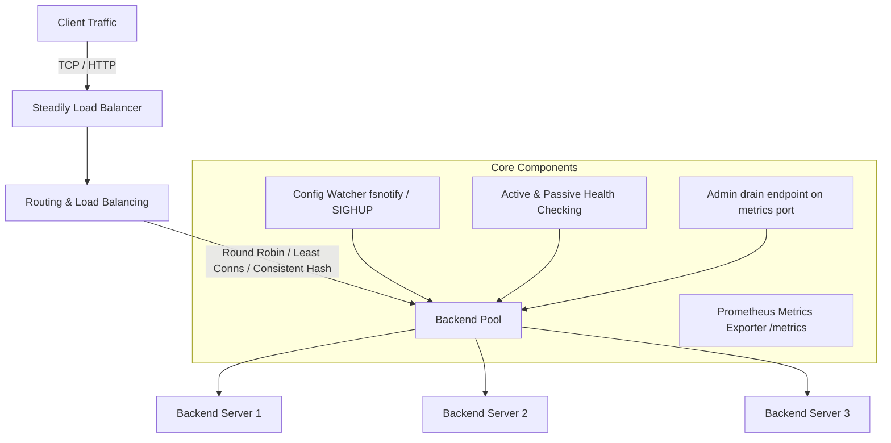

# Steadily

[](https://github.com/Prabodh-dev/steadily/actions/workflows/ci.yml)
[](LICENSE)

A TCP and HTTP load balancer in Go that notices when a backend fails, stops sending it traffic, and applies configuration changes without dropping in-flight requests.


The recording shows, in order: round-robin routing across three backends, an active health check failing and traffic moving off that backend, a backend killed mid-traffic with all 200 requests still succeeding, and a hot configuration reload that swaps a backend while requests keep flowing. It is generated by [`scripts/demo/record.sh`](scripts/demo/record.sh).

## Why Steadily

Most failures a load balancer sees are partial: one backend slow, one process gone, one deploy replacing a node. The interesting question is what happens to the requests already in flight and to the ones that arrive in the next second. Steadily is built around answering that precisely:

- A backend that fails a health check, or a real request, is out of rotation before the next request is routed.
- A recovering backend returns only after a configurable number of consecutive successful checks, so a flapping node does not bounce in and out.
- A backend removed by config or by the drain endpoint receives no new requests but finishes the ones it has, up to a drain timeout.
- A config reload never drops in-flight requests and never leaves zero healthy backends while healthy ones exist.
- On SIGTERM or SIGINT it stops accepting connections, drains up to `shutdown_timeout`, and exits cleanly.

These rules are covered by integration tests that run against real `httptest` servers, including 500 concurrent requests while a backend is shut down mid-stream.

## Features

- **L7 HTTP proxying** with longest-prefix path routing, backend groups, `X-Forwarded-*` and `X-Request-ID` headers, and automatic retry on another backend after an upstream failure.
- **L4 TCP proxying** with bidirectional streaming and dial-time failover.
- **Algorithms**: round robin, least connections, and consistent hashing (160 virtual nodes per backend; key from a header, a cookie, or the client IP).
- **Health checking**: periodic active HTTP or TCP probes plus passive detection from transport errors and 502, 503 and 504 responses.
- **Hot reload** from a file change or `SIGHUP`.
- **Prometheus metrics** and a ready-made Grafana dashboard.

Steadily does not terminate TLS. Read [SECURITY.md](SECURITY.md) for its trust boundaries and known limitations before exposing it to the internet.

## Install

### Release binaries

Download the archive for your platform from the [latest release](https://github.com/Prabodh-dev/steadily/releases/latest). Builds are published for Linux, macOS and Windows on amd64 and arm64, with a `checksums.txt` file.

```bash
# Linux amd64 example; adjust VERSION, OS and ARCH as needed
VERSION=0.1.0
curl -fsSLO "https://github.com/Prabodh-dev/steadily/releases/download/v${VERSION}/steadily_${VERSION}_linux_amd64.tar.gz"
curl -fsSLO "https://github.com/Prabodh-dev/steadily/releases/download/v${VERSION}/checksums.txt"
sha256sum --check --ignore-missing checksums.txt
tar -xzf "steadily_${VERSION}_linux_amd64.tar.gz"
./steadily -version
```

Each archive also contains `steadily.example.yaml`, `README.md` and `LICENSE`. Windows archives are `.zip`.

### With Go

```bash
go install github.com/Prabodh-dev/steadily/cmd/steadily@latest
```

### From source

```bash
git clone https://github.com/Prabodh-dev/steadily.git
cd steadily
go build ./cmd/steadily
```

## Quickstart

This runs the balancer in front of three local echo backends from this repository. Any HTTP servers work as backends; point `health_check.path` at a URL that returns 2xx.

```bash
git clone https://github.com/Prabodh-dev/steadily.git && cd steadily

# three backends
go run ./backends/echo -addr 127.0.0.1:8081 &
go run ./backends/echo -addr 127.0.0.1:8082 &
go run ./backends/echo -addr 127.0.0.1:8083 &

# a config that points at them
cat > steadily.local.yaml <<'YAML'
listen_address: "127.0.0.1:8080"
metrics_address: "127.0.0.1:9090"
mode: "l7"
algorithm: "round_robin"
health_check:
  path: "/health"
  interval: "1s"
  timeout: "500ms"
  healthy_threshold: 2
  unhealthy_threshold: 1
backends:
  - { name: "echo1", address: "127.0.0.1:8081" }
  - { name: "echo2", address: "127.0.0.1:8082" }
  - { name: "echo3", address: "127.0.0.1:8083" }
YAML

steadily -config steadily.local.yaml      # or: go run ./cmd/steadily -config steadily.local.yaml
```

In another terminal:

```bash
for i in $(seq 6); do curl -s localhost:8080/; echo; done   # responses rotate across the backends
curl -s localhost:8082/fail                                 # make echo2 fail its health check
sleep 2; for i in $(seq 6); do curl -s localhost:8080/ | grep -o '"address":"[^"]*"'; done
curl -s localhost:8082/recover                              # echo2 rejoins after 2 passing checks
curl -s localhost:9090/metrics | grep '^steadily_'
```

To change the backend list, edit `steadily.local.yaml` and save it, or run `kill -HUP <pid>`. Removed backends drain; new ones start receiving traffic once they pass health checks.

### Docker Compose

Starts Steadily with three echo backends, Prometheus and Grafana:

```bash
docker compose up -d --build
```

- Proxy: `http://localhost:8080/`
- Metrics: `http://localhost:9090/metrics`
- Prometheus UI: `http://localhost:9091`
- Grafana: `http://localhost:3000` (anonymous admin; local use only)

`go run ./scripts/demo-kill` brings the stack up, kills a backend mid-traffic, and reports the result.

## Architecture



More detail, including the health state machine and draining design, is in [docs/design.md](docs/design.md).

## Configuration Reference

Steadily loads YAML configuration provided via `-config` flag or `STEADILY_CONFIG` environment variable.

```yaml
listen_address: ":8080"
metrics_address: "127.0.0.1:9090" # /metrics and POST /admin/drain; keep on a trusted interface
mode: "l7" # "l4" or "l7"
algorithm: "round_robin" # "round_robin", "least_connections", "consistent_hashing"
consistent_hash_key: "header:X-User-ID" # "header:<Name>", "cookie:<Name>", or client IP
shutdown_timeout: "5s"
drain_timeout: "10s"
admin_token: ""         # optional bearer token for POST /admin/drain on metrics_address

health_check:
  path: "/health"
  interval: "1s"
  timeout: "500ms"
  healthy_threshold: 1
  unhealthy_threshold: 1

backends:
  - name: "echo1"
    address: "echo1:8081"
    weight: 1
    draining: false
  - name: "echo2"
    address: "echo2:8082"
    weight: 1
  - name: "echo3"
    address: "echo3:8083"
    weight: 1

groups:
  - name: "main"
    backends: ["echo1", "echo2", "echo3"]

routes:
  - path_prefix: "/"
    group: "main"
```

## Admin Control API

Mark a backend as draining via HTTP POST. The endpoint is served only on `metrics_address`, never on the public listener:

```bash
curl -X POST -H "Authorization: Bearer $STEADILY_ADMIN_TOKEN" \
  "http://localhost:9090/admin/drain?backend=echo1"
```

Set `admin_token` in the config (or the `STEADILY_ADMIN_TOKEN` environment variable) to require a bearer token. Without a token the endpoint is unauthenticated, so bind `metrics_address` to a trusted interface such as `127.0.0.1:9090`.

## Metrics

`/metrics` on `metrics_address` exposes `steadily_requests_total`, `steadily_request_duration_seconds`, `steadily_active_backends`, `steadily_draining_backends`, `steadily_health_check_failures_total`, `steadily_health_check_duration_seconds` and `steadily_in_flight_requests`. If `metrics_address` is empty in L7 mode, `/metrics` is served on the public listener and the admin endpoint is disabled.

## Tests and benchmarks

```bash
go test -race ./...        # unit and integration tests
go vet ./...
go run ./scripts/chaos     # failure-injection suite
go run ./scripts/bench     # benchmark suite; rewrites docs/benchmarks.md
```

Measured throughput reaches up to 9,726 req/sec at 200 concurrent connections in the in-process benchmark; see [docs/benchmarks.md](docs/benchmarks.md) for the full table.

## Documentation

- [docs/design.md](docs/design.md): architecture, algorithms, health state machine, draining and reload
- [docs/benchmarks.md](docs/benchmarks.md): measured results
- [SECURITY.md](SECURITY.md): trust boundaries, known limitations, how to report a vulnerability
- [CONTRIBUTING.md](CONTRIBUTING.md): building, testing, code map, pull requests

## Contributing

Contributions are welcome. Start with [CONTRIBUTING.md](CONTRIBUTING.md) and look for issues labeled `good first issue`. Please follow the [Code of Conduct](CODE_OF_CONDUCT.md).

## License

MIT. See [LICENSE](LICENSE).
